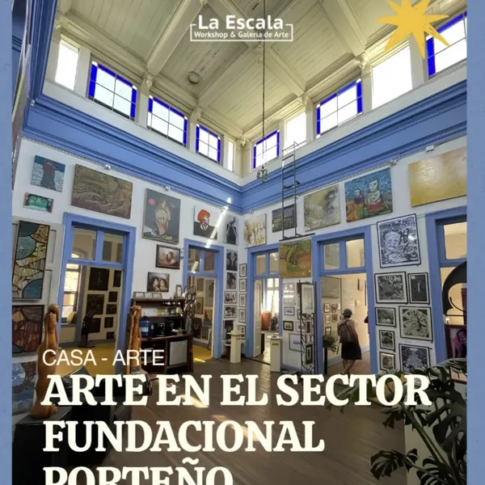

# La Escala · Workshop & Galería de Arte

Rediseño del sitio web de **La Escala**, galería de arte emergente porteño, talleres y café en una casa centenaria del Barrio Puerto de Valparaíso. Tiene dos entradas, Cochrane 553 y Blanco 568, y abre de lunes a sábado, de 11:00 a 18:00, con entrada liberada.

Proyecto final · **Diseño desde el Código** · Diseño PUCV · 2026
Diseño y código: Gloria García · Investigación: A. C., F. D. y G. G.

- Wireframes y sistema visual: Figma *La Escala — Wireframes y sistema visual*.
- Tienda: el sitio enlaza a la tienda que ya existe en [laescala.cl](https://www.laescala.cl), donde se compran obras y cupos de talleres.
- Documentación del proyecto (sistema de diseño, clases aplicadas, pauta, accesibilidad y registro de páginas): `La-Escala-documentacion-proyecto.pdf`, entregado aparte del sitio.

## Páginas

| Archivo | Contenido |
|---|---|
| `index.html` | Inicio: portada, dos entradas, lo que hay en sala, agenda de la semana, artistas, plano, café, tienda e Instagram |
| `exposiciones.html` | En sala ahora, próximamente y memoria de la casa |
| `exposicion.html` | Ficha de exposición (lee `?id=`) |
| `artistas.html` | Los 14 artistas de la galería, buscador, índice A–Z y filtro por técnica |
| `artista.html` | Ficha de artista: biografía, técnicas e hitos (lee `?id=`) |
| `agenda.html` | Calendario, lista y descarga `.ics` (en teléfono solo lista) |
| `talleres.html` | 7 talleres con horario, valor y tallerista, y formulario de consultas |
| `cafe.html` | Café La Escala, entrada por Blanco 568 |
| `la-casa.html` | Historia y plano de los espacios |
| `visitanos.html` | Dirección, horario, cómo llegar, accesibilidad y contacto |
| `privacidad.html` | Política de privacidad (Ley 21.719) |
| `404.html` | Página no encontrada |

## Estructura

```
la-escala/
├── *.html            páginas
├── css/styles.css    una sola hoja de estilos
├── js/datos.js       contenidos: artistas, exposiciones, talleres, eventos y espacios del plano
├── js/main.js        interacciones
├── fonts/            Montserrat (WOFF2, licencia OFL)
├── img/              logos, retratos e imágenes en WebP
├── favicon.svg · robots.txt · sitemap.xml · llms.txt
└── README.md
```

## Cómo trabajar en VS Code

1. Clonar el repositorio (VS Code: **Git: Clonar**, o GitHub Desktop).
2. Instalar la extensión **Live Server** y abrir `index.html` con **Open with Live Server**.
3. Para ordenar el código después de editar: **Formatear documento** (`Shift + Alt + F` / `Shift + Option + F`).
4. Guardar cambios en GitHub: **Control de código fuente → Confirmar → Sincronizar**.

**Dónde se edita cada cosa**

- Textos de cada página → en su `.html`.
- Fichas de artistas y de exposiciones, eventos de la agenda y espacios del plano → `js/datos.js`.
- Colores, tipografía y espacios → variables al inicio de `css/styles.css`.

## Publicar en GitHub Pages

**Settings → Pages → Deploy from a branch → `main` / `(root)`.** El sitio queda en `https://gloria-garcia.github.io/<nombre-del-repo>/`. Si el repositorio no se llama `la-escala`, hay que reemplazar esa dirección en los `<head>`, `sitemap.xml`, `robots.txt` y `llms.txt` (**Editar → Reemplazar en archivos**).

## Fotografías

Las fotos de las salas, los afiches de talleres y eventos, la obra de Óscar Barra y las publicaciones de Instagram ya están en `img/` en formato WebP. Si se cambia una foto, se reemplaza el archivo **con el mismo nombre** ([squoosh.app](https://squoosh.app) convierte a WebP gratis) y se actualiza su `alt`.

| Archivos | Qué son |
|---|---|
| `hall-central`, `sala-exposicion-vigente`, `casa-interior`, `entrada-celia-castro` | Fotos de la casa |
| `espacio-*` | Una foto por espacio del plano (cafetería, Sala Zen, Salón Celia Castro, salas de exposición, bazar, colección, oficina y taller, accesos) |
| `cafe-mesas`, `cafe-muros` | Café La Escala |
| `taller-*`, `talleres-portada` | Afiches de los talleres y foto del taller |
| `expo-*` | Afiches de eventos (Lienzos Sonoros, FIERAS, café conciertos, clase de cine) y obra de Óscar Barra |
| `instagram-01…06` | Publicaciones de Instagram |
| `artista-*` | Retratos de los artistas |

### Vincular las publicaciones de Instagram

En `index.html`, sección «La Escala en Instagram», cada cuadro es un enlace con una imagen:

```html
<li>
  <a href="https://www.instagram.com/p/CODIGO-DEL-POST/" target="_blank" rel="noopener">
    
  </a>
</li>
```

1. En Instagram abre la publicación, toca **⋯ → Copiar enlace** y pégalo en el `href`.
2. Guarda la imagen del post como `img/instagram-01.webp` (y así con 02 a 06).
3. Escribe en el `alt` qué muestra la imagen.

Se eligió enlace e imagen en vez del código «Insertar» de Instagram, porque ese código carga scripts externos que hacen la página más lenta y comparten datos de las visitas con Instagram.

## Por confirmar con la galería

- Qué hay hoy en cada sala del plano, la Sala Zen y el Bazar (`ESPACIOS` en `js/datos.js`; si un espacio no tiene dato, se muestra «por confirmar»).
- La próxima exposición temporal.
- En qué lugar de Valparaíso abrió La Escala en 2017, antes de llegar a calle Cochrane.
- Si los talleres semanales siguen en noviembre.
- El nombre «Oscar Barra»: su ficha dice «Oscar Ibarra» en el título y «Oscar Barra» en la biografía.

## Formularios

GitHub Pages no tiene servidor: los formularios validan y muestran el mensaje de éxito, pero no envían datos. Para recibir mensajes de verdad se puede usar un servicio como Formspree, cambiando el `action` de cada `<form>`.

## Verificación (29 oct 2026)

- W3C Nu Html Checker: 12 páginas sin errores.
- CSS: sin errores de sintaxis (comprobar también en [jigsaw.w3.org/css-validator](https://jigsaw.w3.org/css-validator/) al publicar).
- Lighthouse móvil: Accesibilidad 100 · Buenas prácticas 100 · SEO 100 · Rendimiento 90–95 con las fotos reales · CLS 0.
- Sin desbordes horizontales en 320, 360, 390, 768, 1024, 1180 y 1440 px.
- 70 pruebas de interacción (menú, buscador, filtros, fichas, calendario, plano, galería, formularios, sin conexión): todas pasan.

## Créditos

- Contenidos: laescala.cl, Instagram @laescalagaleria, Revista CASA Nº 137 (2022) y las fichas de artistas de la galería.
- Tipografía: [Montserrat](https://fonts.google.com/specimen/Montserrat), SIL Open Font License (`fonts/OFL-Montserrat.txt`).
- Uso de IA: se usó un asistente de IA (Claude) como apoyo para escribir y revisar partes del código. La investigación, la arquitectura, el diseño, la selección de contenidos y la revisión final son del equipo.
